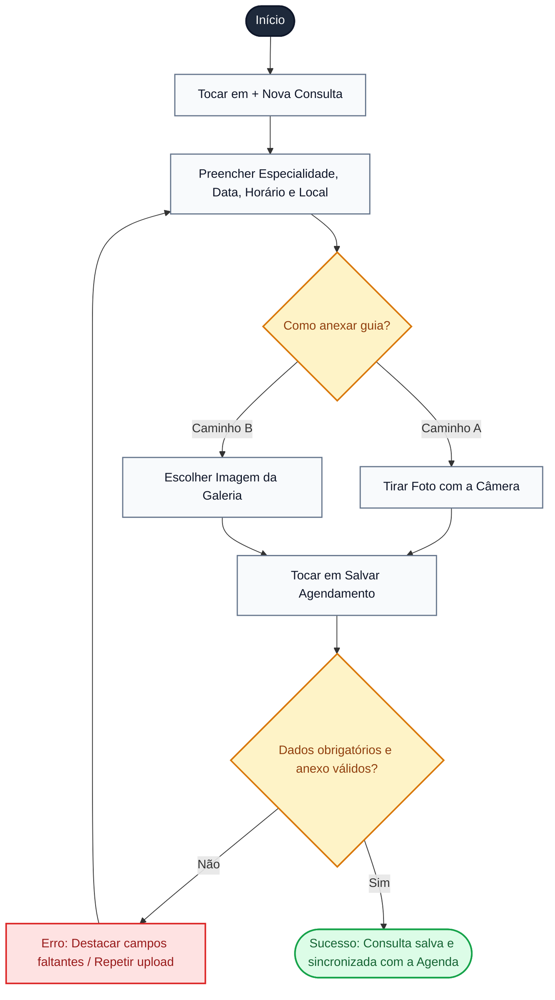
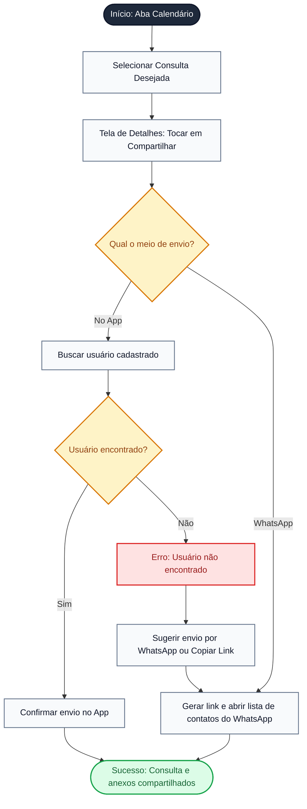
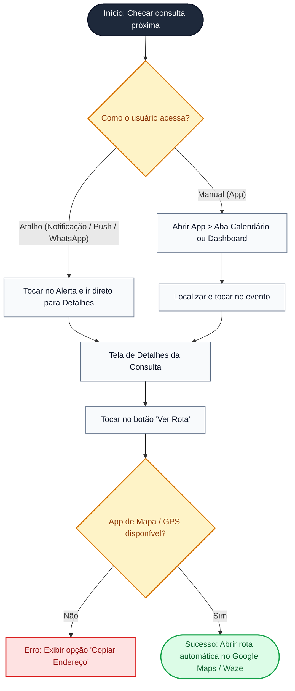
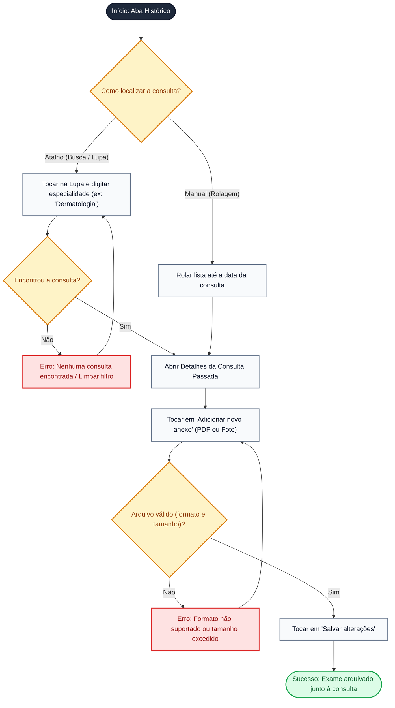

# Arquitetura de Informação e Fluxo do Usuário

Esta entrega define a estrutura de navegação do aplicativo e os caminhos percorridos pelo usuário para realizar as tarefas principais antes da etapa de prototipação.

---

## 1. Arquitetura de Informação (Sitemap)

### 1.1. Telas e Seções Principais

O aplicativo utiliza uma barra de navegação inferior fixa com **4 seções principais**, além do fluxo inicial de acesso:

* **0. Acesso e Onboarding:** Login/Cadastro e configuração inicial de permissões (sincronização com Google/Apple Calendar e alertas no WhatsApp).
* **1. Início (Dashboard):**
  * Resumo da próxima consulta com botão rápido **"Ver Rota"**
  * Alertas de retornos pendentes (ex.: voltar em 6 meses)
  * Botão flutuante (**+**) para novo agendamento
* **2. Calendário:**
  * Visão mensal/lista de agendamentos
  * Filtro de perfil (Titular ou Familiar)
  * Formulário de Novo Agendamento (com upload de guia médica)
  * Detalhes da Consulta (com opção de compartilhamento)
* **3. Histórico:**
  * Linha do tempo de consultas passadas
  * Barra de pesquisa por especialidade (Lupa)
  * Repositório de documentos para anexar resultados de exames
* **4. Perfil e Lembretes:**
  * Dados médicos básicos do usuário
  * Cadastro de dependentes/familiares
  * Configuração da antecedência dos avisos (1 semana, 2-3 dias ou 1 dia antes via WhatsApp/Push)

---

### 1.2. Hierarquia das Telas (Diagrama de Sitemap)

> **Descrição Visual:** Organograma hierárquico (de cima para baixo) com fundo neutro e caixas arredondadas em tons de azul e cinza, estruturado a partir do acesso inicial até os submódulos da barra inferior.

```mermaid
graph TD
    classDef root fill:#1E3A8A,stroke:#1E40AF,stroke-width:2px,color:#FFFFFF;
    classDef main fill:#2563EB,stroke:#1D4ED8,stroke-width:2px,color:#FFFFFF;
    classDef sub fill:#F8FAFC,stroke:#94A3B8,stroke-width:1.5px,color:#0F172A;

    Root["0. Login e Onboarding<br/>(Permissões WhatsApp + Agenda)"]:::root

    Root --> D["1. Início (Dashboard)"]:::main
    Root --> C["2. Calendário"]:::main
    Root --> H["3. Histórico"]:::main
    Root --> P["4. Perfil e Lembretes"]:::main

    D --> D1["1.1 Card Próxima Consulta<br/>(Ver Rota)"]:::sub
    D --> D2["1.2 Alertas de Retorno<br/>(6 meses)"]:::sub
    D --> D3["1.3 Botão + Nova Consulta"]:::sub

    C --> C1["2.1 Visão Mensal / Lista"]:::sub
    C --> C2["2.2 Filtro Titular / Familiar"]:::sub
    C --> C3["2.3 Novo Agendamento<br/>(Anexar Guia)"]:::sub
    C --> C4["2.4 Detalhes da Consulta<br/>(Compartilhar / Ver Rota)"]:::sub

    H --> H1["3.1 Lista de Consultas Passadas"]:::sub
    H --> H2["3.2 Busca por Especialidade (Lupa)"]:::sub
    H --> H3["3.3 Detalhes Passados<br/>(Adicionar Resultado de Exame)"]:::sub

    P --> P1["4.1 Histórico Médico Básico"]:::sub
    P --> P2["4.2 Gestão de Familiares"]:::sub
    P --> P3["4.3 Configurar Alertas<br/>(WhatsApp e Agenda Nativa)"]:::sub
```

---

### 1.3. Justificativa da Organização

A estrutura foi dividida em **4 abas rasas** (máximo de 3 cliques até qualquer função) para resolver diretamente as dores mapeadas nas personas e no cenário:

* **Centralização de Guias e Retornos (Persona Giselle e Cenário de Análise):** A separação entre Calendário (futuro) e Histórico (passado) com anexo direto de fotos/PDFs no evento evita que Giselle perca pedidos de exames em gavetas. O alerta de retorno no Dashboard resolve o esquecimento de consultas de rotina de 6 meses.
* **Zero Esforço Manual e Acesso Rápido (Persona Lucas):** O Dashboard coloca a próxima consulta e o botão "Ver Rota" na primeira tela, além de sincronizar automaticamente com o calendário nativo do celular e enviar links diretos no WhatsApp.
* **Acompanhamento de Terceiros (Persona Roberto):** O filtro de dependentes no Calendário, a busca rápida por especialidade no Histórico e o compartilhamento via WhatsApp permitem gerenciar exames e consultas da família sem confusão.

---

## 2. Fluxo do Usuário (User Flow)

Abaixo estão os **4 fluxos principais do aplicativo** (alinhados com a Análise de Tarefas), contendo objetivo, regras de decisão, estados de erro/sucesso, atalhos e a representação visual de cada fluxograma.

### Legenda dos Fluxogramas

| Símbolo | Tipo | Descrição |
| :--- | :--- | :--- |
| `([ Texto ])` | Início / Fim | Pontos de partida e encerramento do fluxo |
| `[ Texto ]` | Tela / Ação | Ação executada pelo usuário ou tela apresentada |
| `{" Texto "}` | Ponto de Decisão | Bifurcação baseada em escolha ou validação do sistema |
| Estado Vermelho | Erro | Falha na validação, inexistência de dado ou serviço indisponível |
| Estado Verde | Sucesso | Conclusão positiva da tarefa |

---

### 2.1. Fluxo 1: Agendar uma nova consulta com anexo

* **Explicação e Objetivo:** Permite cadastrar uma consulta (especialidade, data, hora e local) e fotografar ou anexar a guia médica de papel no mesmo momento. O objetivo do usuário (Giselle) é garantir que o compromisso vá para o calendário já com o pedido de exame salvo, evitando a perda do papel físico.
* **Passos do Fluxo:**
  1. **Início:** Usuário abre o app e toca em "Nova Consulta" (no Calendário ou botão flutuante `+`).
  2. **Tela Intermediária:** Preenche Especialidade, Data, Horário e Local no formulário.
  3. **Ponto de Decisão 1 (Origem do Anexo):** Escolhe entre Capturar foto com a câmera ou Selecionar imagem da galeria.
  4. **Ponto de Decisão 2 (Validação):** Toca em "Salvar". O sistema verifica se Data, Hora e Especialidade estão preenchidos e se a imagem é válida.
  5. **Estado de Erro:** Exibe alerta *"Preencha os campos obrigatórios"* ou *"Arquivo inválido"* e retorna ao formulário.
  6. **Estado de Sucesso:** Salva a consulta, sincroniza com o calendário do celular e exibe confirmação *"Consulta agendada com sucesso!"*.
* **Atalhos e Caminhos Alternativos:**
  * **Atalho:** Botão flutuante (`+`) na tela de Início permite agendar sem precisar entrar na aba Calendário.
  * **Alternativa:** O usuário pode preencher especialidade, data e hora em qualquer ordem e optar por salvar a consulta sem anexo, adicionando a guia posteriormente.

#### Fluxograma 1

---

### 2.2. Fluxo 2: Compartilhar informações da consulta com familiar

* **Explicação e Objetivo:** Permite enviar os dados completos de um agendamento (data, horário, especialidade, médico, endereço e guia anexa) para outra pessoa. O objetivo do usuário (Roberto) é organizar e repassar facilmente os compromissos e pedidos de exames dos familiares.
* **Passos do Fluxo:**
  1. **Início:** Usuário seleciona a consulta desejada na aba Calendário.
  2. **Tela Intermediária:** Abre a tela de Detalhes da Consulta e toca em "Compartilhar".
  3. **Ponto de Decisão 1 (Meio de Envio):** Escolhe entre Adicionar usuário no App ou Enviar link pelo WhatsApp.
  4. **Ponto de Decisão 2 (Validação do Destino):** Verifica se o usuário existe no sistema (opção App) ou se o envio no WhatsApp foi concluído.
  5. **Estado de Erro:** Caso o usuário não seja encontrado no app, exibe *"Usuário não encontrado"* e oferece o botão rápido de enviar por WhatsApp ou copiar o link.
  6. **Estado de Sucesso:** Exibe confirmação *"Consulta compartilhada!"* e libera o acesso aos detalhes e guias para o familiar.
* **Atalhos e Caminhos Alternativos:**
  * **Caminho Alternativo Externo:** Se o familiar não tiver o aplicativo instalado, o usuário usa o caminho alternativo do WhatsApp, que gera um resumo em texto com o link direto para visualizar a guia médica.

#### Fluxograma 2

---

### 2.3. Fluxo 3: Visualizar detalhes e endereço de uma consulta próxima

* **Explicação e Objetivo:** Apresenta o horário e o local de uma consulta próxima e abre a rota de navegação diretamente no aplicativo de mapas. O objetivo do usuário (Lucas) é consultar o endereço rapidamente antes de sair de casa e traçar o caminho no GPS sem esforço.
* **Passos do Fluxo:**
  1. **Início:** Usuário precisa checar os dados da consulta próxima.
  2. **Ponto de Decisão 1 (Forma de Acesso):** Acessa pelo alerta de lembrete (notificação) ou abre o aplicativo manualmente.
  3. **Tela Intermediária:** Visualiza a tela de Detalhes da Consulta (horário, médico e endereço) e toca no botão "Ver Rota".
  4. **Ponto de Decisão 2 (Disponibilidade de Mapa):** O sistema verifica se o Google Maps ou Waze está disponível com GPS ativo.
  5. **Estado de Erro:** Caso falhe a abertura do app de mapa, exibe alerta com botão *"Copiar Endereço"* para a área de transferência.
  6. **Estado de Sucesso:** Abre o Google Maps/Waze com o endereço da clínica já preenchido e rota traçada.
* **Atalhos e Caminhos Alternativos:**
  * **Atalho Principal (Notificação):** Tocar na notificação de véspera (Push ou link do WhatsApp) leva o usuário direto para a Tela de Detalhes, pulando a tela inicial e o calendário.
  * **Atalho Secundário (Dashboard):** Se abrir o app normalmente, o card no topo da tela Início já possui o botão direto "Ver Rota".

#### Fluxograma 3

---

### 2.4. Fluxo 4: Adicionar resultado de exame a uma consulta já realizada

* **Explicação e Objetivo:** Permite abrir o registro de um atendimento passado e fazer o upload de resultados de exames (PDF ou fotos). O objetivo do usuário (Giselle / Roberto) é manter o histórico centralizado para levar os resultados facilmente na consulta de retorno.
* **Passos do Fluxo:**
  1. **Início:** Usuário acessa a aba Histórico.
  2. **Ponto de Decisão 1 (Localização):** Escolhe entre usar a Barra de Pesquisa (Lupa) ou Rolar a lista manualmente.
  3. **Tela Intermediária:** Abre os Detalhes da Consulta Passada, toca em "Adicionar novo anexo" e seleciona o arquivo no celular.
  4. **Ponto de Decisão 2 (Validação do Arquivo):** Verifica se o arquivo está em formato suportado (PDF, JPG, PNG) e dentro do limite de tamanho.
  5. **Estado de Erro:** Se o arquivo for inválido ou a busca na lupa não retornar nada, exibe mensagem de erro (*"Nenhuma consulta encontrada"* ou *"Formato de arquivo não suportado"*).
  6. **Estado de Sucesso:** Usuário toca em "Salvar alterações" e o exame fica arquivado junto à consulta.
* **Atalhos e Caminhos Alternativos:**
  * **Atalho de Busca (Lupa):** Para históricos longos, digitar a especialidade (ex: "Dermatologia") filtra a consulta imediatamente sem precisar rolar a tela.
  * **Caminho Alternativo (Rolagem):** Para consultas recentes, basta tocar no primeiro card no topo da lista da aba Histórico.

#### Fluxograma 4

